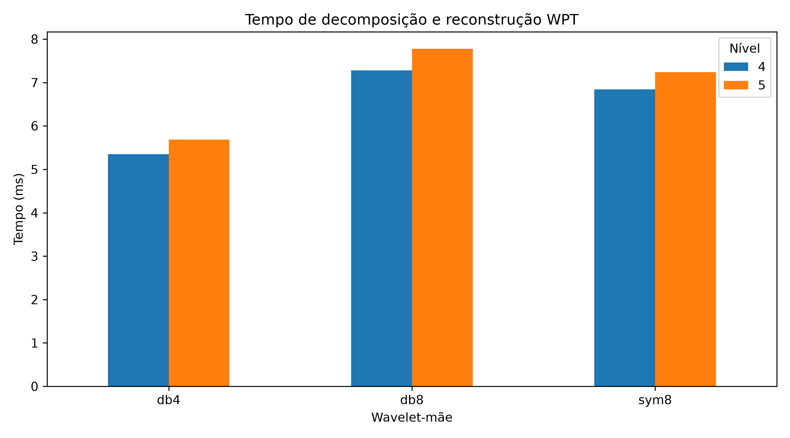
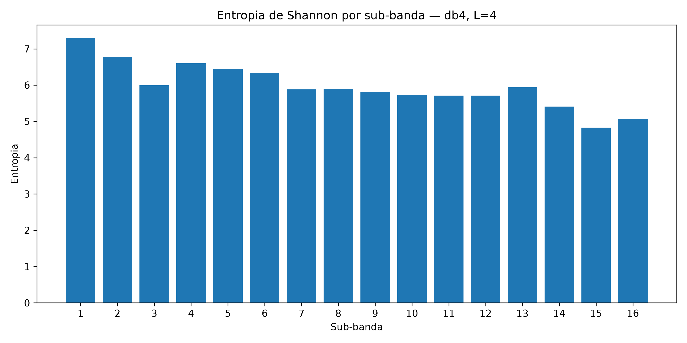
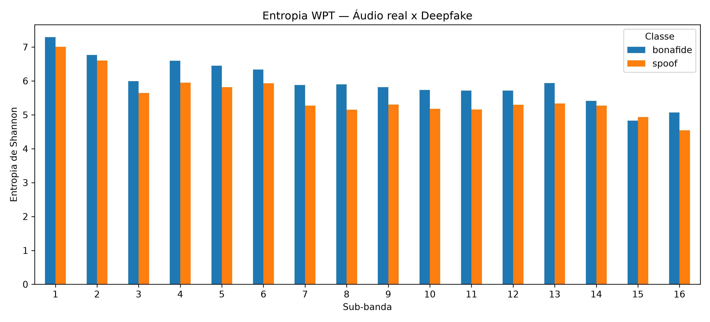

# Detecção de Deepfakes de Áudio em Português Brasileiro com Wavelet Packet Transform


Projeto de Iniciação Científica e Tecnológica (PIBITI–CNPq) desenvolvido na **Faculdade de Tecnologia de Ourinhos (Fatec Ourinhos)**, com vigência de **setembro de 2026 a agosto de 2027**.

**Pesquisador:** Thiago Mateus Schiavi  
**Orientador:** Prof. Dr. Alex Marino Gonçalves de Almeida  
**Curso:** Análise e Desenvolvimento de Sistemas  
**Instituição:** Fatec Ourinhos

## Visão geral

A pesquisa investiga a detecção de fala sintética (*spoof*) em português brasileiro por meio da **Wavelet Packet Transform (WPT)** e de descritores estatísticos extraídos das sub-bandas reconstruídas no domínio do tempo.

A proposta é construir uma biblioteca reutilizável de extração de características e avaliá-las com métodos clássicos de aprendizado de máquina, priorizando **execução em CPU** e reprodutibilidade. O plano contempla métricas como **Equal Error Rate (EER)** e **minimum Detection Cost Function (min-DCF)**.

> **Estado atual (outubro de 2026):** o repositório reúne scripts de preparação dos dados, experimentos exploratórios de WPT, reconstrução de sub-bandas, entropia de Shannon e um fichamento teórico. **Ainda não há um detector treinado e validado nem resultados finais de EER/min-DCF.**

## Objetivos

- Preparar e documentar conjuntos de fala real (*bona fide*) e sintética (*spoof*) em português brasileiro.
- Decompor áudios pela WPT e reconstruir sub-bandas no domínio temporal.
- Investigar energia, RMS, cruzamentos por zero (ZCR), envelope via Hilbert, entropia e fatores de forma e de crista.
- Produzir vetores de características para treinamento e avaliação de classificadores.
- Analisar contribuição das sub-bandas, desempenho de detecção e custo computacional em CPU.

## Dados e subconjunto piloto

O corpus utilizado nos experimentos iniciais é o [BRSpeech-DF](https://huggingface.co/datasets/AKCIT-Deepfake/BRSpeech-DF). As partições originais `train`, `validation` e `test` foram preservadas na seleção piloto.

| Partição | Bona fide | Spoof | Total |
|---|---:|---:|---:|
| Treino (`train`) | 100 | 100 | 200 |
| Validação (`validation`) | 100 | 100 | 200 |
| Teste (`test`) | 100 | 100 | 200 |
| **Total** | **300** | **300** | **600** |

Os áudios do piloto foram convertidos para **WAV, 16 kHz, mono, PCM de 16 bits**, preservando os arquivos de origem localmente. A seleção utilizou os primeiros 100 registros do primeiro grupo de linhas do primeiro Parquet correspondente a cada classe e partição, portanto **não é uma amostragem aleatória ou representativa de todo o corpus**.

**Limitações metodológicas importantes:** os Parquets inspecionados não apresentaram identificadores explícitos de locutor. Assim, **não foi possível comprovar ausência de vazamento de locutor (*speaker leakage*)** entre as partições. Também não foi estabelecida ausência de duplicação de conteúdo entre elas. O CSV atual é **um subconjunto piloto**, não uma partição definitivamente validada por locutor. A definição do protocolo final depende de revisão metodológica com o orientador.

Os áudios brutos e processados **não são distribuídos neste repositório**. Consulte as condições de uso e licença do corpus na fonte original.

## Estrutura do projeto

```text
PIBITI-main/
├── data/
│   ├── audios/                  # Originais (somente local; ignorados pelo Git)
│   ├── processados/             # WAV 16 kHz mono (somente local)
│   └── metadados/              # Inventários e CSVs do piloto
├── src/                        # Scripts Python dos experimentos
├── feature/                    # Área destinada às características extraídas
├── splits/                     # Protocolos de partição, quando validados
├── results/                    # CSVs e resultados dos experimentos
├── reports/
│   ├── metodologia_particao_mes2.md
│   └── fichamento_wpt/         # LaTeX, PDFs e gráficos
├── requirements.txt
├── environment.yml
└── README.md
```

Os diretórios podem evoluir conforme o desenvolvimento do projeto. Os caminhos dos scripts devem ser executados **a partir da raiz do repositório**, pois vários deles utilizam caminhos relativos.

## Instalação (Linux / execução em CPU)

Recomendado: **Python 3.12** em ambiente virtual.

```bash
git clone https://github.com/thiagoschiavi06/PIBITI.git
cd PIBITI
python3 -m venv venv
source venv/bin/activate
python -m pip install --upgrade pip
python -m pip install numpy pandas scipy soundfile PyWavelets matplotlib pyarrow huggingface_hub
```

O repositório também contém `requirements.txt` e `environment.yml`; confira-os antes de utilizá-los como definição integral do ambiente, pois as dependências podem mudar ao longo da pesquisa.

Verificação rápida:

```bash
python -c "import numpy, pandas, scipy, soundfile, pywt, matplotlib, pyarrow, huggingface_hub; print('Ambiente OK')"
```

## Scripts disponíveis

| Script | Função |
|---|---|
| `01_inventario_parquets.py` | Listagem de arquivos Parquet do corpus |
| `02_inventario_quantidades.py` | Inventário da quantidade de registros |
| `03_inspecionar_parquet.py` | Inspeção de esquema e grupos de linhas |
| `04_extrair_amostra.py` | Extração de amostras dos Parquets |
| `05_inspecionar_audios.py` | Verificação de formato e frequência dos áudios |
| `06_converter_para_16k.py` | Conversão para WAV mono de 16 kHz |
| `07_criar_csv_piloto.py` | Organização e validação de metadados piloto |
| `08_testar_cpu_wpt.py` | Testes iniciais de tempo em CPU |
| `09_decomposicao_wpt.py` | Decomposição e energia das sub-bandas |
| `10_reconstrucao_completa_wpt.py` | Reconstrução completa e erro numérico |
| `11_reconstrucao_subbanda_wpt.py` | Reconstrução de uma sub-banda |
| `12_reconstruir_16_subbandas.py` | Reconstrução individual e soma das 16 sub-bandas |
| `13_comparar_wavelets.py` | Comparação preliminar db4, db8, sym8, L=4/5 |
| `14_entropia_shannon.py` | Entropia por sub-banda |
| `15_comparar_entropia_real_spoof.py` | Comparação exploratória entre dois áudios |
| `16_selecao_base_entropia.py` | Exemplo local de seleção por custo de entropia |
| `17_gerar_graficos_wpt.py` | Gráficos para o fichamento |

Exemplos com áudios já preparados localmente:

```bash
python src/09_decomposicao_wpt.py
python src/10_reconstrucao_completa_wpt.py
python src/12_reconstruir_16_subbandas.py
python src/13_comparar_wavelets.py
python src/14_entropia_shannon.py
python src/17_gerar_graficos_wpt.py
```

> **Atenção:** scripts que leem `data/processados/` exigem os arquivos de áudio disponíveis localmente. Fazer apenas o `git clone` não baixa o corpus. Scripts de acesso remoto podem demandar conexão com o Hugging Face. Confira parâmetros e caminhos antes de executar.

## Resultados exploratórios — outubro de 2026

### Reconstrução WPT

No áudio `bonafide_train_00000.wav`, a configuração **db4, L=4** produziu **16 sub-bandas**. A reconstrução completa apresentou:

- **127.275 amostras**, antes e depois da reconstrução.
- **MSE:** `2.677104e-34`.
- **Erro máximo absoluto:** `2.220446e-16`.

A soma das 16 sub-bandas reconstruídas individualmente (antes da gravação em PCM16) apresentou **MSE = `3.306160e-34`**, numericamente equivalente ao sinal original.

### Comparação entre wavelets e níveis

| Wavelet | Nível | Sub-bandas | Tempo medido (ms) | MSE |
|---|---:|---:|---:|---:|
| db4 | 4 | 16 | 5,35 | 2,68 × 10⁻³⁴ |
| db4 | 5 | 32 | 5,69 | 3,78 × 10⁻³⁴ |
| db8 | 4 | 16 | 7,28 | 4,26 × 10⁻³⁴ |
| db8 | 5 | 32 | 7,78 | 5,99 × 10⁻³⁴ |
| sym8 | 4 | 16 | 6,84 | 4,83 × 10⁻²⁸ |
| sym8 | 5 | 32 | 7,24 | 6,96 × 10⁻²⁸ |

Tempos obtidos com **um único áudio** e incluindo decomposição e reconstrução. **Não representam benchmark estatístico nem desempenho de detecção.**

### Entropia de Shannon

Com WPT `db4`, `L=4`, no áudio real analisado:

- Maior entropia: **banda 1 (`aaaa`) = 7,2939**.
- Menor entropia: **banda 15 (`daad`) = 4,8307**.

Na comparação exploratória de **um áudio real e um sintético**, o áudio real apresentou entropia maior em **15 de 16 sub-bandas**; a maior diferença absoluta ocorreu na banda 8 (**0,7487**). Esse resultado **não permite inferir capacidade de discriminação** entre classes: conteúdo, duração e outras condições podem influenciar a comparação.

Um teste local de seleção de base por custo entrópico indicou divisão do nó `a` (custo do pai: **1036,652721**; soma dos filhos: **861,304004**). **Não se trata ainda do algoritmo completo de *best basis*.**

### Gráficos







## Documentação

- [Fichamento teórico e experimental WPT — PDF](reports/fichamento_wpt/fichamento_wpt_mes2_final.pdf)
- [Fonte LaTeX do fichamento](reports/fichamento_wpt/fichamento_wpt_mes2_final.tex)
- [Metodologia da partição piloto](reports/metodologia_particao_mes2.md)
- [Resultados tabulares](results/)

## Próximas etapas

1. Revisar com o orientador o protocolo de partição e a questão da identificação de locutores.
2. Validar a decomposição e a reconstrução em mais sinais e áudios, incluindo efeitos de borda.
3. Implementar e consolidar os descritores estatísticos das sub-bandas.
4. Montar matrizes de características e treinar os classificadores do núcleo (**GMM e XGBoost**).
5. Avaliar **EER, min-DCF e custo em CPU**; documentar limitações e ampliar experimentos conforme viabilidade.

## Referências iniciais

- Coifman, R. R.; Wickerhauser, M. V. (1992). *Entropy-based algorithms for best basis selection*.
- Lee, G. R. et al. (2019). *PyWavelets: A Python package for wavelet analysis*.
- Mallat, S. (2009). *A Wavelet Tour of Signal Processing*.
- [BRSpeech-DF — Hugging Face](https://huggingface.co/datasets/AKCIT-Deepfake/BRSpeech-DF).

---

**Projeto acadêmico em desenvolvimento.** Os resultados apresentados são preliminares e devem ser interpretados no contexto das limitações metodológicas descritas acima.
